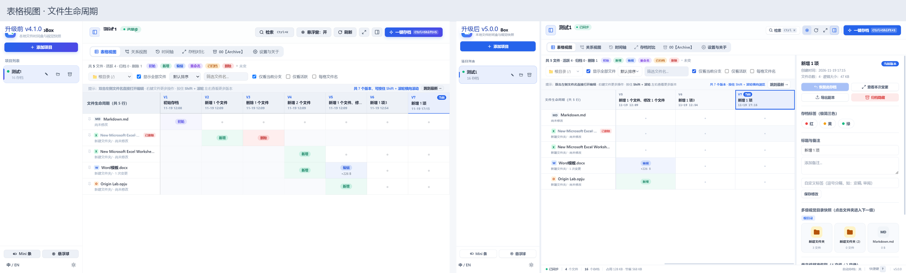
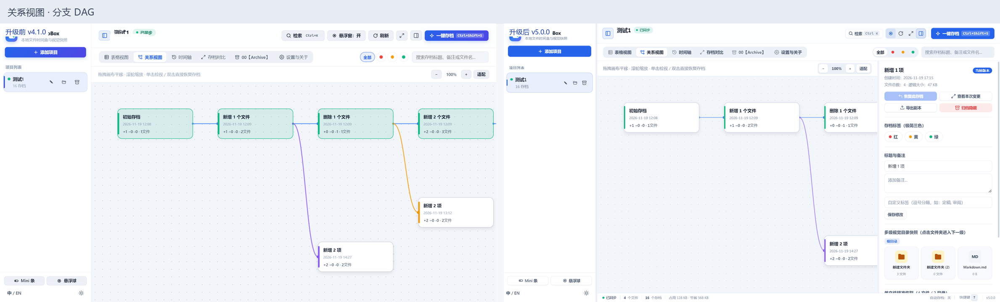
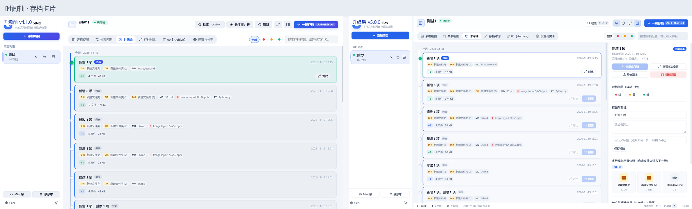
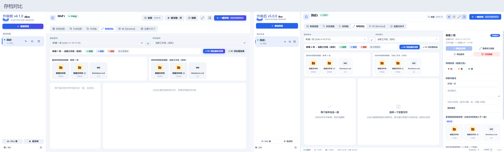
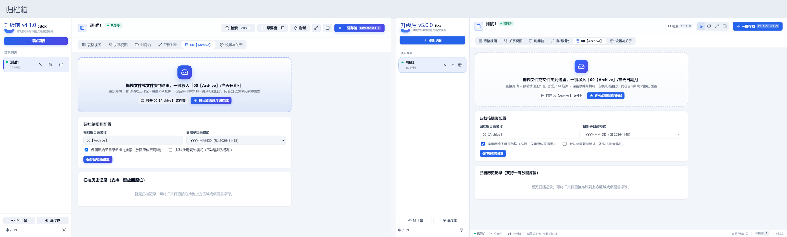
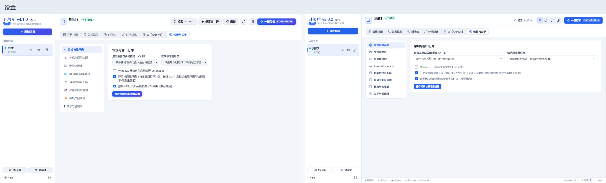
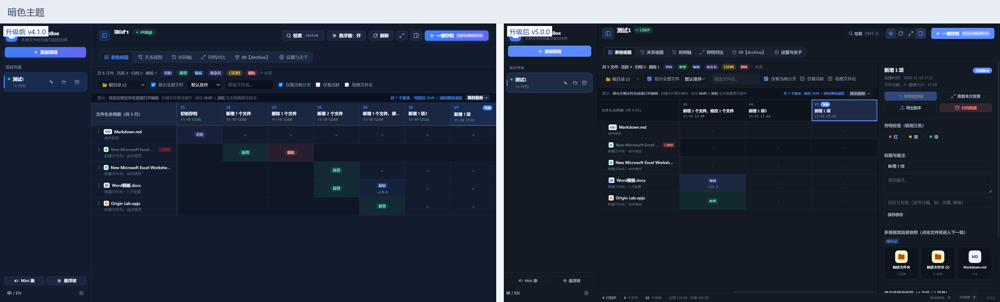
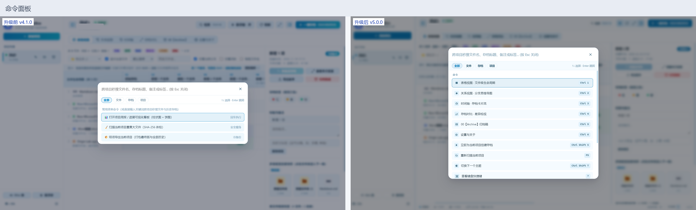
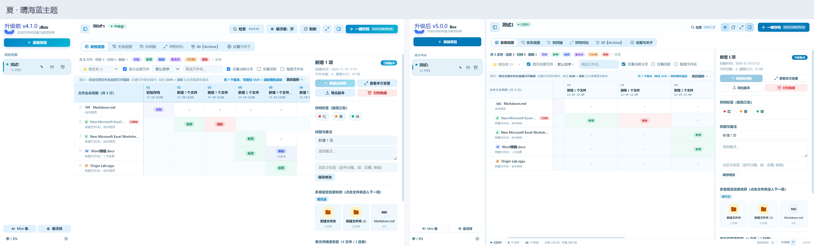

# 时匣 ChronoBox 升级报告 · v4.1.0 → v5.0.0

> 主题：**从「能用」到「顺手」** —— 一次以界面系统重构为先导、并补齐交互与可维护性的版本升级。
> 升级日期：2026-11-19　·　代码基线：v4.1.0（已备份于 `_backup/src-v4.1.0/`）

---

## 一、先做体检：升级前到底哪里不对

动手之前先把整套代码与运行界面看了一遍（2126 行主样式表、2449 行主渲染逻辑、17 个核心模块），并在真实工程 `（本地测试工程）`（16 个存档）上跑起来截了基线图。

结论是：**引擎很强，外壳拖了后腿。**

核心引擎（SHA-256 内容寻址去重、时间盒子回溯、分支 DAG、临时历史、归档箱、结项打包）有 53 项自动化测试兜底，稳。问题几乎全部集中在「你看得见的那一层」。

### 1.1 界面层问题

| # | 现象 | 影响 |
|---|---|---|
| U1 | **右侧详情栏永不隐藏**：切到「设置」「归档箱」这类全局页，右边仍挂着某条存档的标题、标签、恢复按钮 | 语义错位，白占 332px；设置页最明显 |
| U2 | **表格视图版本列固定 108px**，标题被截成「新增 1 个文件、修…」 | 这一页是默认首页，可读性直接决定第一印象 |
| U3 | 表格视图**列宽只在首次渲染时算一次**，拖窗口不重算 | 窗口一变就必须横向滚 |
| U4 | 时间轴**每次后台刷新都整段重建 DOM**，`innerHTML=''` 把滚动位置一并抹掉 | 正在翻旧存档时被弹回顶部 |
| U5 | 时间轴「当前分支」用**整块绿色填充**标识 | 存档一多就像一片荧光贴纸，重点反而没了 |
| U6 | 空态处理粗糙：对比视图两个大白框各写一行灰字 | 像「没加载出来」而不是「本来就没有」 |
| U7 | 设置页导航用 emoji（⚙ 🎨 ⌨ 💾 📦），Windows 下渲染成彩色字形 | 和其余线性 SVG 图标体系打架 |
| U8 | 按钮高度 30/32/34 混杂、主按钮用渐变+上浮位移 | 现代感偏旧，且视觉重心不稳 |
| U9 | 无焦点样式、无 Esc 统一关闭、无键盘可达性 | 纯鼠标操作，效率工具却不好用键盘 |
| U10 | 无底部状态栏 | 「几个文件 / 几个存档 / 占多少空间 / 自动存档开没开」要去别处翻 |

### 1.2 功能层缺口

| # | 缺口 |
|---|---|
| F1 | 命令面板（Ctrl+K）只有 3 条硬编码命令，不能切视图、切主题、开设置 |
| F2 | 没有快捷键速查表 —— 快捷键写在说明书里，用的人看不到 |
| F3 | 视图、分栏状态不记忆，每次开都要重新摆 |
| F4 | 左右栏宽度不可调 |
| F5 | 误点「恢复存档」之后没有任何即时退路（只能再手动切回去） |
| F6 | 主题切换按钮是 6 档循环，想回浅色要按 4 次 |

### 1.3 发现的缺陷

| # | 缺陷 | 说明 |
|---|---|---|
| B1 | 表格视图列宽与 CSS 常量不一致（JS 252 / CSS 245） | 粘性列与表头错位 |
| B2 | `.no-scrollbar` 同时设了 `scrollbar-width: thin` | Chromium 下会强制回退到系统原生滚动条，Windows 11 上是一条粗灰槽，把「极简」直接打破 |
| B3 | 四季主题只覆盖了部分 token | 与 `:root` 混用后部分组件配色漂移 |
| B4 | 悬浮球未跟踪态文案写成「未加」 | 语义不完整 |
| B5 | 偏差：`rightCollapsed`/`leftCollapsed` 定义在 `bindEvents()` 内部 | 其他模块想联动折叠得靠 DOM 猜状态，是 U1 的根因 |

---

## 二、升级做了什么

一句话：**重做设计语言 → 重排骨架 → 把交互补齐 → 顺手修掉上面每一处缺陷。**

### 2.1 设计系统（`tokens.css` 全面重写）

- **语义化分层**：画布 `--bg-app` / 凹陷 `--bg-sunken` / 面板 `--bg-surface` / 浅控件 `--bg-subtle` / 悬停 `--bg-hover`，五层固定，组件不再各调各的。
- **新增阶梯**：字号 `--fs-2xs…2xl`、圆角 `--radius-xs…xl`、间距 `--sp-1…8`、动效 `--dur-1/2/3` + 两条缓动曲线。
- **色板重做**：主色保持品牌蓝 `#2563EB`，但细化为 `accent / hover / active / soft / ring` 五档；暗色主题整体提亮对比度（画布 `#0A0F16`、面板 `#131A24`）。
- **四季主题补全**：春/夏/秋/冬四套现在都定义了完整的画布、表面、描边、文字、主色、阴影六组取值，不再依赖浅色兜底。
- **无障碍**：全局 `:focus-visible` 焦点环、`prefers-reduced-motion` 降级、`::selection` 统一。
- 原有 36 个变量名 **100% 保留**，历史代码零改动即可吃到新视觉。

### 2.2 骨架与信息架构

- **底部状态栏**（26px）：项目状态、文件数、存档数、磁盘占用与节省、自动存档状态、快捷键入口、版本号。所有「我得去别处查」的数据现在常驻一行。
- **左右分栏可拖拽调宽**（双击复位，宽度写入 localStorage）；专注模式会自动隐藏状态栏腾出垂直空间。
- **右侧详情栏按视图自适应**：设置 / 归档箱这类全局页自动让位，回到数据视图自动还原 —— 这条直接消掉了 U1。
- **顶栏收束**：6 个等权按钮 → 「检索（带 Ctrl K）」+ 一个图标组 + 主操作，主次分明。
- **视图可记忆**：关掉再开还停留在上次那一页。

### 2.3 组件层

| 组件 | 升级点 |
|---|---|
| 按钮 | 统一 32px 高，主按钮改实色 + 内高光，按压有回弹，`btn-sm=26px` 自成体系 |
| 输入 | 统一 32px，搜索框默认浅底、聚焦转白底 + 3px 焦点环 |
| 选择器 | 自绘下拉箭头，不再依赖系统外观 |
| 徽章/标签 | 走 `--radius-pill`，字号下沉到 10–11px，等宽数字对齐 |
| 弹窗 | 统一 `header / body / footer`，遮罩加模糊，入场用回弹曲线；body 独立滚动，长表单不再撑破屏 |
| Toast | 加类型色点、`column-reverse` 堆叠、离场动画，**并支持挂一个动作按钮**（撤销就用它） |
| 表格视图 | 列宽按可用宽度自适应（136–232px），标题至少能读全；行悬停整行联动；「未变」格子简化为一个小点的安静标记 |
| 关系视图 | 节点去绿底，改白底 + 发丝边 + 左侧分支色条；当前节点用主色描边 + 主色角标；连线变细变淡，`hover` 描边高亮 |
| 时间轴 | 卡片去绿底改左侧色条；操作按钮从「悬停才出现」改为「低透明度常驻、悬停变实」；日期分隔线吸顶 |
| 对比视图 | 两个大白框换成带图标的空态块；文件清单选中项加左侧主色条 |
| 设置页 | emoji 图标 → 8 个线性 SVG；导航吸顶；内容区放宽到 1120px |
| 命令面板 | 命令分组 + 键位提示 + 模糊匹配；↑↓/Enter 可键盘全程操作 |

### 2.4 新功能

1. **命令面板升级（Ctrl+K）**：13 条真实命令 —— 6 个视图直达、立即存档、重扫、切主题、快捷键表、周报、重复文件体检、结项导出；输入关键词时「命令」与「搜索命中」分组并存。
2. **快捷键速查表（`?`）**：导航 / 操作 / 表格视图三组，屏幕上一眼可查。
3. **撤销恢复**：恢复存档成功后，Toast 上直接挂「撤销」按钮，12 秒内一键退回切换前状态（自动先做保护存档）。
4. **状态栏**：见 2.2。
5. **分栏拖拽 + 宽度记忆**。
6. **视图记忆**。
7. **滚动位置保持**：后台刷新不再把时间轴/对比视图弹回顶部。
8. **「跟随系统」主题**：补上此前只有类型定义、没有入口的 `system` 模式，纳入主题循环与设置页色卡（现共 7 套）。
9. **完整键盘层**：`Ctrl+1…6` 切视图、`F5` 重扫、`Ctrl+Shift+T` 切主题、`Ctrl+Shift+F` 专注模式、`Esc` 关闭任意弹层、`?` 速查表。

### 2.5 缺陷修复对照

| 编号 | 修复方式 |
|---|---|
| B1 | JS 文件列常量统一为 236px，与 CSS 一致 |
| B2 | 移除 `scrollbar-width`，只用 WebKit 伪元素做 7px 细条，`hover` 加深 |
| B3 | 四季主题补齐完整 token 组 |
| B4 | 「未加」→「未跟踪」 |
| B5 | `left/rightCollapsed` 与 `applyPaneState()` 提到模块作用域，新增 `syncInspectorForView()` 统一裁决 |
| B6 | `applyTheme` 早已支持 `system`，但没有任何 UI 入口 —— 现纳入主题循环与设置页色卡 |
| B7 | 设置页 `settings-wrap` 类此前从未挂上（`max-width` 死锁在 720px），现已挂载 |

---

## 三、升级前后对照

### 3.1 表格视图（默认首页）

- 升级前：版本列窄到标题被截断，右侧固定挂着一块存档详情，底部空荡无信息。
- 升级后：列宽自适应、标题完整可读、底部出现状态栏；右侧详情栏保留（本页确实需要），但换成更清晰的层级。

### 3.2 关系视图

节点从「绿色块」变成「白卡 + 分支色条」，当前节点用主色描边和角标强调；连线减细，画布不再被颜色噪声填满。

### 3.3 时间轴

整块绿色高亮改为左侧色条；「对比 / 回溯」不再隐身，低透明度常驻、悬停变实;日期分组标题吸顶。

### 3.4 存档对比

空态从「两行灰字」变成带图标的说明块，看一眼就知道是「本来一致」而不是「没加载出来」。

### 3.5 归档箱

拖拽区从淡蓝渐变改为中性描边 + 悬停强调，规则表单换新控件。

### 3.6 设置页

关键变化不只是换皮：**右侧详情栏消失了**，设置页终于能横向铺开；emoji 全部换成线性 SVG；导航卡片吸顶。

### 3.7 暗色主题

画布/面板/描边三层重新配比，表格不再出现「表头比内容还亮」的问题；滚动条从粗灰槽变细线。

### 3.8 命令面板

从 3 条硬编码命令，变成 13 条分组命令 + 键位提示 + 键盘全流程操作。

### 3.9 四季主题

四季主题现在有独立完整的色板，不再与浅色主题混搭。

### 3.10 恢复存档弹窗

弹窗统一间距与按钮层级，恢复成功后新增「撤销」通道。

---

## 四、验证

| 项目 | 结果 |
|---|---|
| `npm run build`（主进程 + 渲染进程 + 资源拷贝） | ✅ 通过，0 error |
| `npm test` 核心引擎全链路 | ✅ **53 / 53 通过，0 失败** |
| UI 冒烟（CDP 驱动真实窗口） | ✅ 6 视图 + 8 个设置分区 + 命令面板 + 12 组快捷键 + 分栏拖拽 + 主题循环，"**运行时错误 0**" |
| 数据兼容 | ✅ 仓库格式、`.chronobox/` 目录、manifest**均未改动**；本次只改渲染层与交互层 |
| 回滚 | ✅ 原 `src/` 完整备份在 `_backup/src-v4.1.0/`，覆盖回来重新 `npm run build` 即可 |

---

## 五、改动文件清单

| 文件 | 改动性质 |
|---|---|
| `src/renderer/styles/tokens.css` | 重写（199 → 372 行）：完整设计令牌 + 6 套主题 + 无障碍 |
| `src/renderer/styles/main.css` | 重写（2127 → 3178 行）：全部在用 class 名原样保留（另新增约 40 个），JS 生成的 DOM 无需改动即获得新外观 |
| `src/renderer/index.html` | 结构升级（591 → 657 行）：分栏拖拽条、底部状态栏、快捷键速查表、顶栏重排 |
| `src/renderer/scripts/app.ts` | 2670 → 3096 行。新增：状态栏、分栏拖拽、视图记忆、上下文详情栏、撤销恢复、命令面板重做、完整键盘层、滚动保持 |
| `src/renderer/scripts/matrixRenderer.ts` | 列宽自适应算法重写、提示条按真实溢出判断 |
| `src/renderer/scripts/diffRenderer.ts` | 空态组件化、二进制对比卡重排 |
| `src/renderer/scripts/graphRenderer.ts` | 节点/连线视觉重构 |
| `src/renderer/scripts/i18n.ts` | 补 2 条词条 |
| `src/renderer/scripts/mini.ts` / `styles/mini.css` | 悬浮球文案与数值排版修正 |
| `package.json` | 版本 4.1.0 → 5.0.0 |
| `tools/*.mjs` | 新增：基于 CDP 的截图 / 冒烟测试工具（后续改 UI 可直接复用做回归） |

---

## 六、建议的下一步

1. **英文界面补齐**：目前 `i18n.ts` 只有 35 组词条，切到 English 后大部分界面仍是中文。建议把 `data-i18n` 铺到全部静态文本，并给动态模板抽 key。
2. **表格视图虚拟滚动**：文件数上千后一次性渲染全部行会卡，建议改成窗口化渲染。
3. **视图状态持久化扩展**：把「仅看当前分支 / 排序方式 / 文件夹筛选」也写进配置。
4. **撤销范围扩大**：删除存档、批量归档也可以走同一套 Toast 撤销通道。
5. **打包签名**：`electron-builder.yml` 目前没有代码签名，分发时 Windows SmartScreen 会拦。

---

*报告生成于 2026-11-19 · 截图取自真实工程 `（本地测试工程）`（16 存档 / 5 文件），1440×840 窗口、150% 缩放。*
