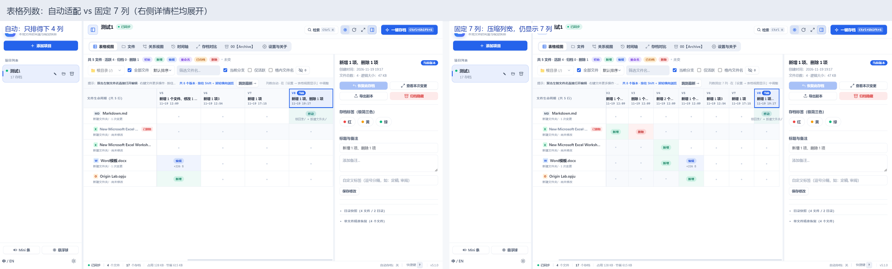
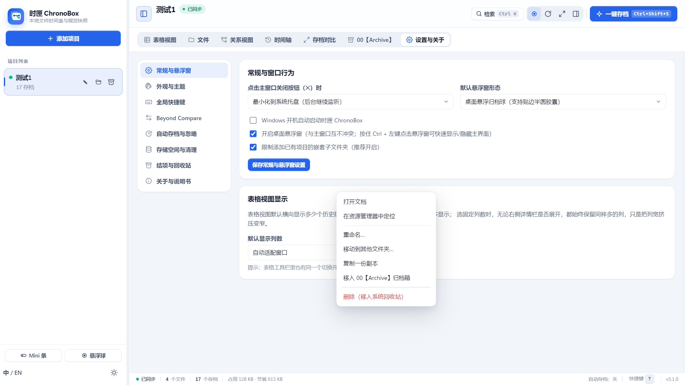
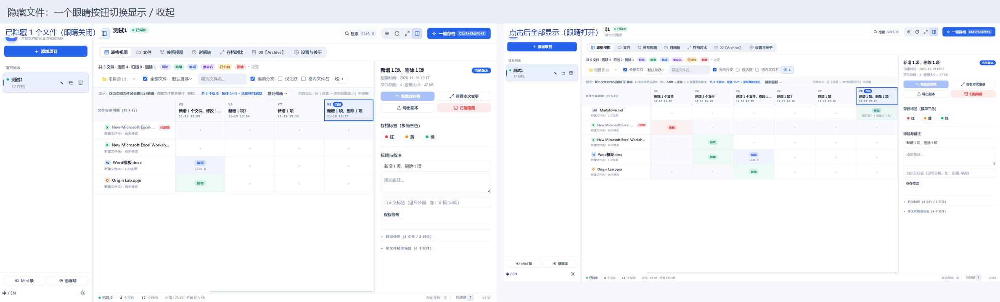
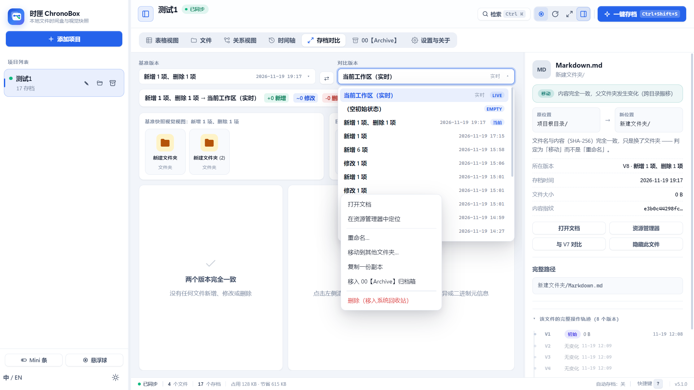
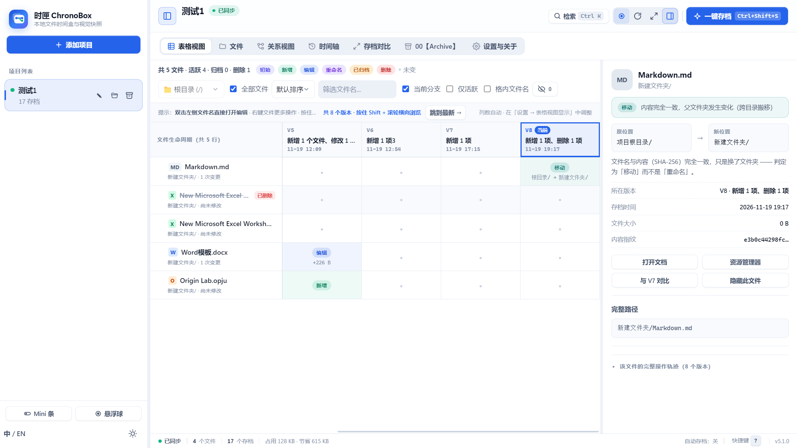
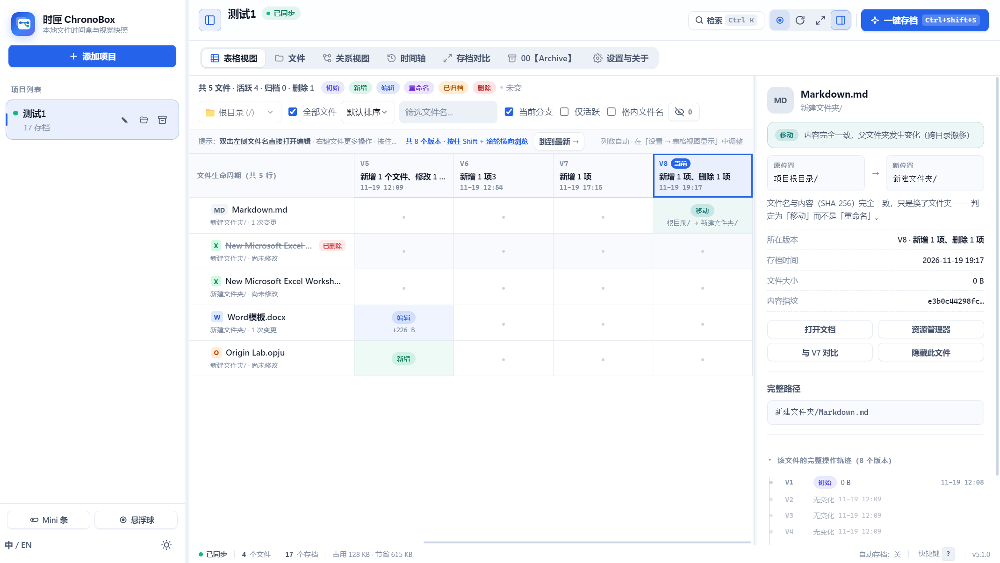
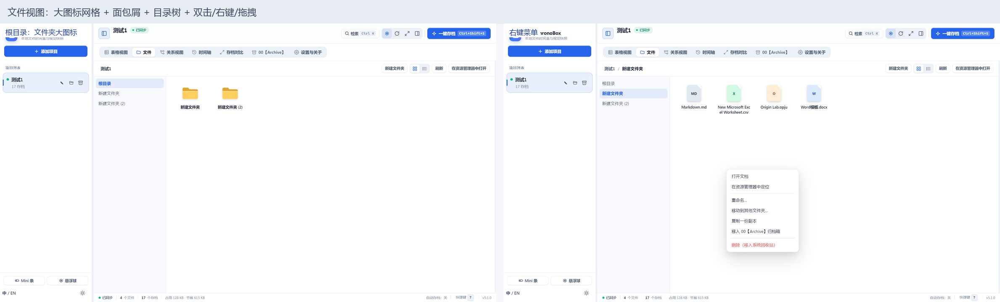
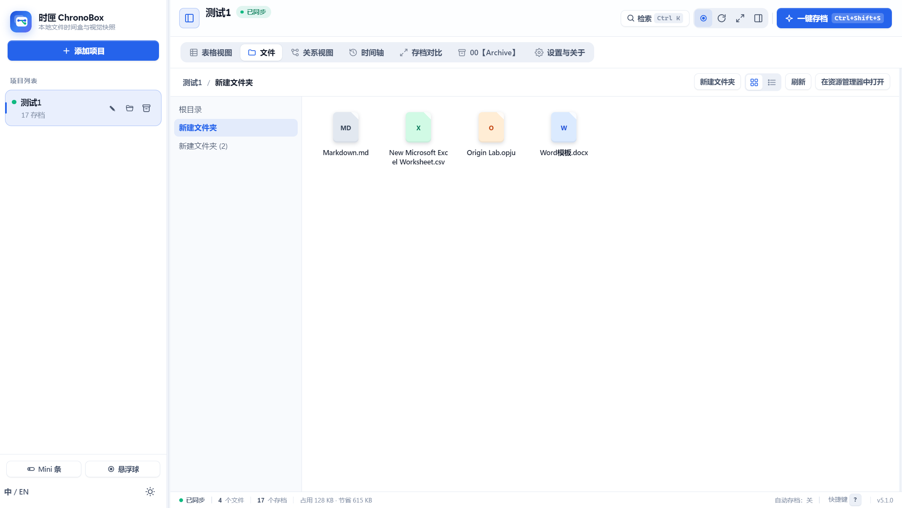

# 时匣 ChronoBox 升级报告 · v5.0.0 → v5.1.0

> 这一轮全部来自你的实测反馈：**7 项界面/交互问题 + 2 个新功能 + 打包**。
> 逐条对照，每条都带截图证据。数据格式与 v5.0.0 / v4.x 完全兼容。

---

## 一、逐条对照

### 1. 侧边栏遮挡 → 改为「挤压」，并新增列数设置

**你的原话**：点右侧栏后应该挤压内容而不是遮住；另外能不能在设置里调默认显示几列。

**问题根因**：不是遮挡，是列数自适应算法在面板变窄时**直接减少列数**（`自动` 模式下从 7 列掉到 4 列），看起来就像内容被挤没了。

**改法**：
- 新增 **列数模式**：`自动适配窗口` 或 **固定 4/5/6/7/8 列**。
- 固定模式下**列数恒定**：把可用宽度直接等分给 N 列，列宽变窄而不是少显示列。
- 设置位置按你的要求放在 **设置 → 常规与悬浮窗 → 表格视图显示**（表格工具栏里只留一行提示文字指向它）。

> 左右两张都是「右侧详情栏展开」的状态。左边自动模式只剩 4 列；右边固定 7 列，可以看到 V2~V8 全部 7 列同时在场，只是被压窄了。

### 2. 隐藏 / 显示文件：一个眼睛按钮

**你的原话**：隐藏和显示文件用一个按钮表示，用类似的图标。

**改法**：表格工具栏原来那个复选框换成**单个眼睛按钮**（Eye / Eye-off），按钮右下角数字就是当前隐藏数量；右键文件名菜单里新增「隐藏此文件 / 取消隐藏此文件」。

### 3. 对比视图下拉菜单：标题左对齐、时间右对齐

原生 `<select>` 的下拉列表无法分栏对齐。改成自绘下拉后，每一行是「标题（左）+ 时间（右，等宽字体）+ 状态角标」。

### 4. 单元格功能：单击看版本、双击看文件

**你的原话**：单击保持看版本信息，双击看单文件信息；顺便补「移动」状态。

- **单击** 单元格 → 右侧仍是「该存档（版本）」的信息。
- **双击** 单元格 → 右侧切换为「**这个文件在这一版发生了什么**」：状态、所在版本、存档时间、文件大小、内容指纹、完整路径，以及**从哪移动到哪 / 复制来源**；底部可展开该文件的完整操作轨迹。
- 右侧栏默认只显示摘要，路径等长信息收在下面，不再一上来就堆满。

### 5. 为什么「移动」被写成了「重命名」

原来的判定只看「内容哈希没变」，于是**同内容跨目录**也算重命名。现在按目录拆开：

| 判定 | 条件 | 颜色 |
|---|---|---|
| **重命名** | 内容哈希一致 **且父目录相同** | 紫 |
| **移动** | 内容哈希一致 **但父目录不同** | 青 |
| **复制** | 新出现的文件，与**本版本中仍然存在**的另一份文件哈希完全一致 | 粉 |

**唯一性判断用的是 SHA-256 内容指纹**（不是文件名、不是大小）。所以：
- 你把 `新建文件夹/` 里的文件搬到 `新建文件夹 (2)/` → 现在显示 **移动**，并写明「原位置 → 新位置」。
- 你复制一份副本，源文件还在 → 显示 **复制**，并写明「复制来源 / 副本位置 / 复制时间」。

### 6. 悬浮球高亮生硬、贴边难看

- 旧版：平直渐变 + 2px 白色硬描边，在深色壁纸上就是一圈硬白边。
- 新版：**径向渐变 + 同色光晕投影 + 内高光**，去掉硬白边；「未跟踪」三字标签单独缩了字号，不再撑满球体。
- 贴边状态从「被窗口切掉一半的圆」改成**真正贴住屏幕边缘的半圆把手**（贴边侧平直、内侧圆角，宽 22px），鼠标移入顺滑弹回完整圆球。

### 7. 文件视图：改成资源管理器式的大图标 + 拖拽

**你的原话**：想要类似 Windows 资源管理器那样的，可以拖拽、右键菜单、打开文件。

现在支持：
- **大图标网格**（黄色文件夹图标 + 按类型着色的文档图标），也可一键切成**详细信息列表**。
- **双击**进目录 / 打开文档；**右键**或行尾「⋯」出菜单。
- **拖拽移动**：把文件/文件夹拖到左侧目录树、面包屑或目标文件夹图标上即可移动（带拖拽高亮）。
- **拖入导入**：从 Windows 资源管理器把文件直接拖进当前目录，自动复制（同名自动加序号）。
- **快捷键**：`F2` 重命名、`Delete` 删除到回收站、`Ctrl+Shift+N` 新建文件夹。
- **安全边界**：所有写操作都锁死在项目根目录内，越界路径直接拒绝。

**已实测通过**：自动化脚本模拟「拖 dragstart → 拖到左侧树 → drop」，文件确实被移动到目标目录（`__dnd_test__` 收到 `Markdown.md`），随后自动清理还原。

### 8. 为什么体积从 275 KB 变成 470 MB

**没有编译出任何东西，是 `npm install` 装进来的 Electron。** 拆开看：

| 占用 | 体积 | 说明 |
|---|---|---|
| `node_modules/` | **440.5 MB** | Electron 运行时（Chromium + Node）本身，装依赖必然产生 |
| `_shots/` | 23.3 MB | 我做升级前后对照的截图（不进交付包） |
| `docs/` | 3.6 MB | 报告 + 前后对照图 |
| `_backup/` | 1.1 MB | 升级前源码备份（回滚用） |
| `dist/` | 1.0 MB | TypeScript 编译产物 |
| **源码 `src/`** | **0.6 MB** | 你原来那个 275 KB 的包就是这个量级 |

原始 zip 是**纯源码包**（49 个文件、无依赖），所以只有 274 KB。

**交付物**（`release/` 目录）：

| 文件 | 体积 | 用途 |
|---|---|---|
| `时匣ChronoBox-5.1.0-Portable.exe` | ≈68 MB | **发给别人直接双击用**，免安装、免 Node.js |
| `ChronoBox-Windows-v5.1.0/` | 4.6 MB | 带版本号的文件夹形态 |
| `ChronoBox-Windows-v5.1.0.zip` | 3.9 MB | 完整源码 + 报告 + 截图 |
| `ChronoBox-Windows-v5.1.0-lite.zip` | **0.33 MB** | 纯源码（和原来 275 KB 同一量级），需自备 Node.js |

---

## 二、验证

| 项目 | 结果 |
|---|---|
| `npm run build` | ✅ 0 error |
| `npm test`（核心引擎） | ✅ **53 / 53 通过** |
| UI 冒烟（7 视图 + 8 设置分区 + 命令面板 + 快捷键 + 拖拽 + 主题） | ✅ **运行时错误 0** |
| 拖拽移动端到端 | ✅ 模拟 dragstart→drop，文件真实移动成功并已还原 |
| 数据兼容 | ✅ 仓库格式 / manifest / 未改动 |

## 三、本轮新增/修改文件

| 文件 | 改动 |
|---|---|
| `src/core/fileMatrix.ts` | 新增 moved / copied 判定（按父目录 + 同版本存活哈希索引） |
| `src/core/types.ts` / `renderer/scripts/types.ts` | 新增状态与 BrowserEntry/BrowserListResult |
| `src/main/ipcHandlers.ts` | 新增 `browser:list/new-folder/rename/move-into/duplicate/trash/reveal/import`，全部做根目录越界校验 |
| `src/preload/index.ts` | 暴露上述 8 个文件操作 API |
| `src/renderer/scripts/app.ts` | 文件视图（网格/列表 + 拖拽）、单元格检视、隐藏文件、自定义下拉、列数设置 |
| `src/renderer/scripts/matrixRenderer.ts` | 固定列数模式、眼睛按钮、移动/复制单元格渲染、提示语 |
| `src/renderer/styles/main.css` / `mini.css` | 网格视图、拖拽高亮、单元格检视、悬浮球重绘 |
| `package.json` | 5.0.0 → **5.1.0** |

## 四、已知限制

1. 固定列数时列宽会被压窄，版本标题会截断（这是「列数优先」的必然代价，自动模式则相反）。
2. 文件视图暂不支持多选批量操作（一次拖一个），也不支持新建空白文件（只能新建文件夹）。
3. 拖拽移动用 `fs.rename`，同一磁盘内是瞬时完成；跨磁盘请用「复制一份副本」。
4. 隐藏文件的清单存在**本机浏览器存储**里（按项目隔离），换机器不会跟着走。

---

## 五、第 3 轮补充修改（v5.1.1）

### 1. 文件视图拖拽「屏闪」已修

**根因有两个，都在拖放高亮的实现上**：

1. `dragleave` 在鼠标经过卡片内部子元素（图标 → 文件名）时会被连续触发 —— 高亮被瞬间关掉又打开，肉眼看就是整屏闪。
2. 高亮样式里把边框从 `1px` 改成 `1.5px dashed`，**边框宽度变了 → 每帧重排** → 内容跟着跳。

**改法**：
- `dragenter/dragover` 只在没有高亮时加类；`dragleave` 用 `relatedTarget` 判断是否真的离开了容器，子元素之间移动不再触发。
- 所有拖放目标 `stopPropagation`，避免父级容器再亮一次。
- 卡片边框宽度**恒定 1.5px**，高亮只改颜色与线型，不触发重排。

**自动化验证**：模拟 12 次「子元素边界穿越」的 dragleave/dragover 循环后，高亮状态仍保持；真正拖出时才熄灭；边框宽度全程不变。

### 2. 文件视图挪到「时间轴」后面

标签栏顺序改为：**表格视图 → 关系视图 → 时间轴 → 文件 → 存档对比 → 00【Archive】 → 设置**（`Ctrl+1…7` 同步调整）。

### 3. 「设置与关于」改名为「设置」

标签栏最后一项从「设置与关于」缩短为「设置」，与其它短标签对齐。

### 4. 「移动」换色 + 图例补齐

- 原来移动用的是青绿色（`#0F766E`），和「新增」的绿色太近。现改为**石板灰蓝**（`#475569`，带 1px 同色内描边），与 初始(靛)/新增(绿)/编辑(蓝)/重命名(紫)/已归档(琥珀)/删除(红) 都能区分。
- 图例（工具条左侧那排）补上 **移动** 与 **复制** 两个色标，共 9 项：初始 / 新增 / 编辑 / 重命名 / **移动** / **复制** / 已归档 / 删除 / 未变。

---

*报告生成于 2026-11-19 · 截图取自真实工程 `（本地测试工程）`（17 存档），1440×840 窗口、150% 缩放。*
